# LR6
Лабораторная работа №6

## Цель работы
Изучение базовых возможностей системы управления версиями, опыт работы с Git Api, опыт работы с локальным и удалённым репозиторием.

## 1. Задание на программирование
Для выполнения лабораторной работы необходимо:
1. Создать аккаунт на сайте GitHub;
2. Сделать копию в личное хранилище из https://github.com/Kurtyanik/LR6/ (Fork);
3. Установить Git;
4. После установки настроить клиент git, введя имя пользователя и email;
5. Клонировать свой личный удалённый репозиторий на компьютер;
6. Добавить файл через интерфейс GitHub. Подтянуть изменения в локальный репозиторий. Работу продолжать локально;
7. Получить историю операций для каждой из веток;
8. Просмотреть последние изменения;
9. Выполнить слияние в ветку master, разрешив конфликт;
10. Удалить побочную ветку после успешного слияния;
11. Сделать изменения и зафиксировать их, оставляя комментарии, несколько раз;
12. Сделать откат коммита;
13. Создать ветку для отчёта.

## 2. Выполнение лабораторной работы

Создание аккаунта на сайте GitHub для этой работы может быть избыточным, поскольку в первом семестре обучения в рамках лабораторной работы №2 предмета «Информатика» аккаунт в системе управления версиями Git уже был создан.

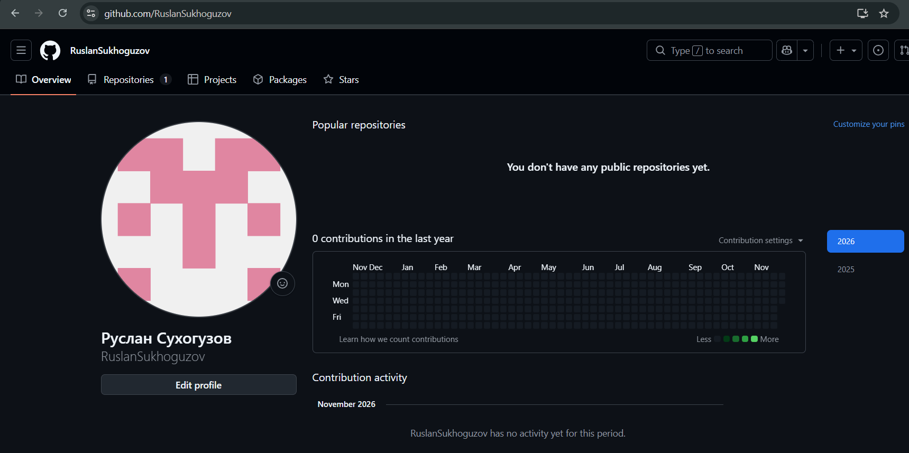

Дальнейшие действия с аккаунтом будут проводиться на нём. Затем была сделана копия (форк) репозитория https://github.com/Kurtyanik/LR6.

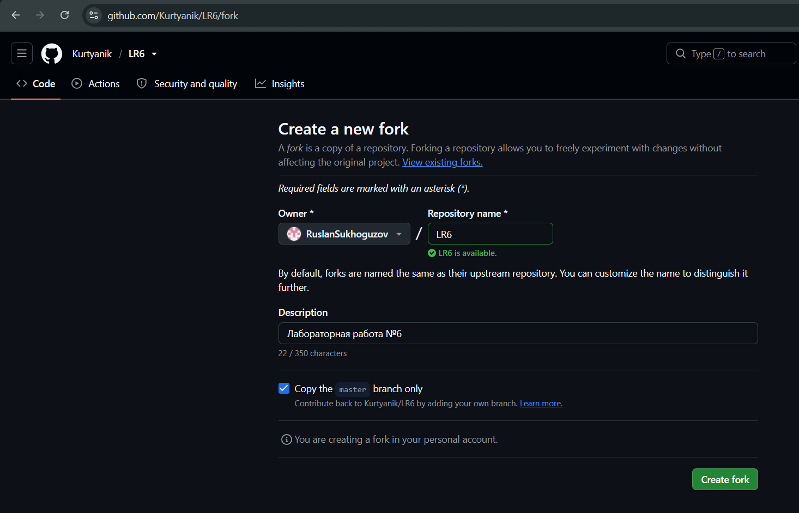

На устройство была установлена последняя на момент выполнения работы система управления версиями Git.

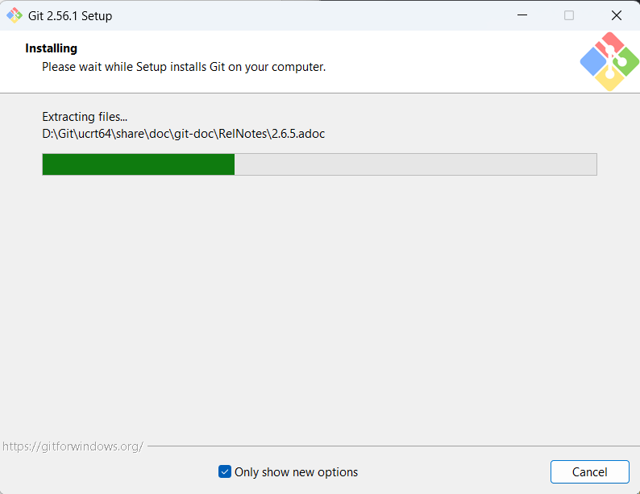

После установки программы она была открыта в папке для выполняемой лабораторной работы. Для настройки клиента git были прописаны команды для присвоения своего имени и email.

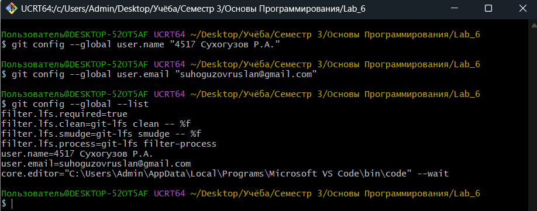

Затем ранее созданный на аккаунте после форка репозиторий был клонирован на компьютер.

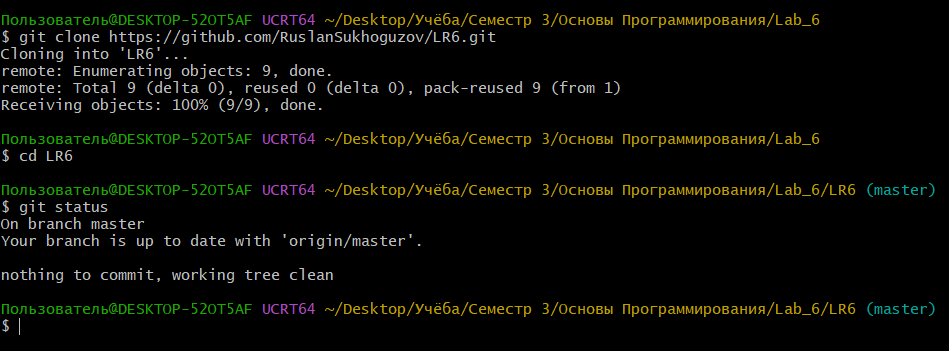

Через веб-интерфейс GitHub в личный форк репозитория были добавлены случайные файлы.

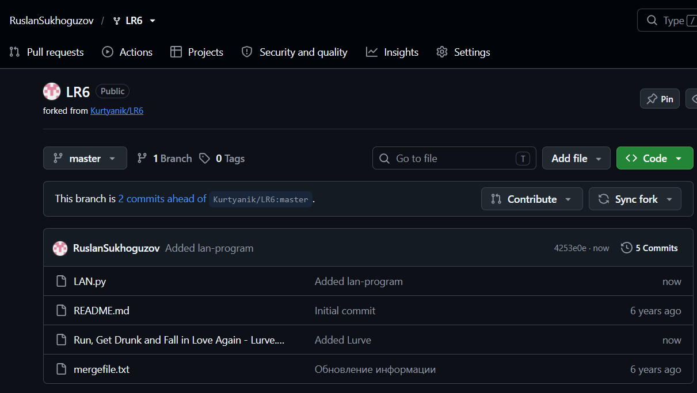

Само собой, файлы не перенеслись автоматически на компьютер. Была введена команда pull для подтягивания изменений в локальный репозиторий.

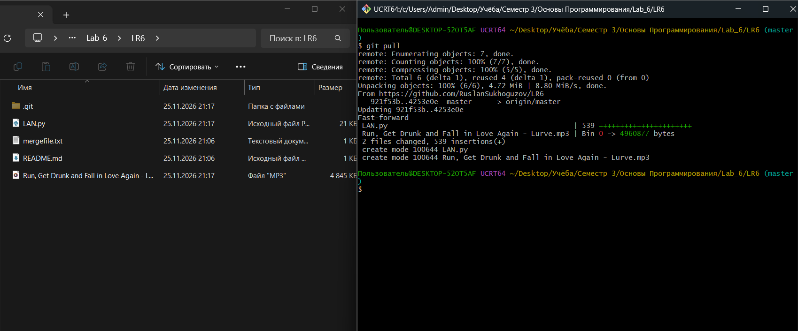

Для получения истории операций для каждой ветки была введена команда branch, вывелись две ветки, хотя на самом деле одна, поскольку ветка HEAD всегда перенаправляет на основную ветку репозитория. Затем для единственной основной ветки при помощи команды log была получена история операций.

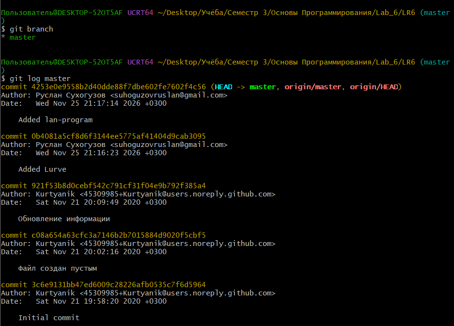

Всё было очень информативно и полезно, последние изменения очень внимательно были просмотрены.

Для разрешения конфликта его необходимо создать, поэтому была создана побочная ветка harmful и отдельно в двух ветках: основной master и другой harmful был изменён один и тот же файл mergefile.txt.

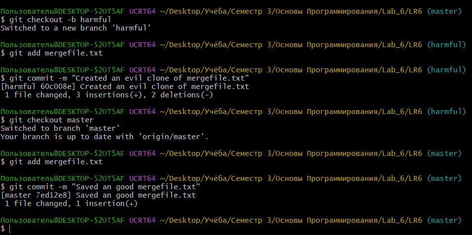

Затем была проведена попытка слияния, которая не удалась из-за созданного конфликта.

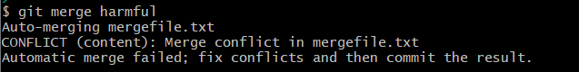

Конфликтный файл заполнился версиями из обеих веток и представлен на рисунке ниже.

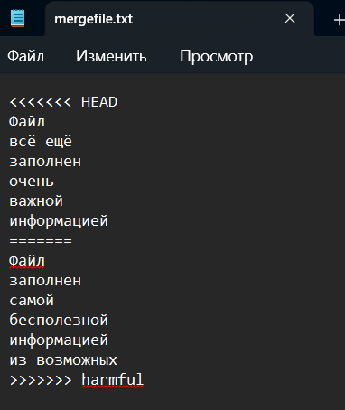

Следуя несправедливости мира, в файле была оставлена версия harmful. Конфликт был разрешён.

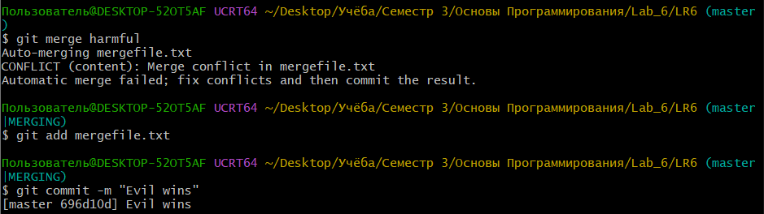

Затем побочная ветка была удалена с помощью команды `git branch –d harmful`.

После этого были проведены некоторые изменения в репозитории.

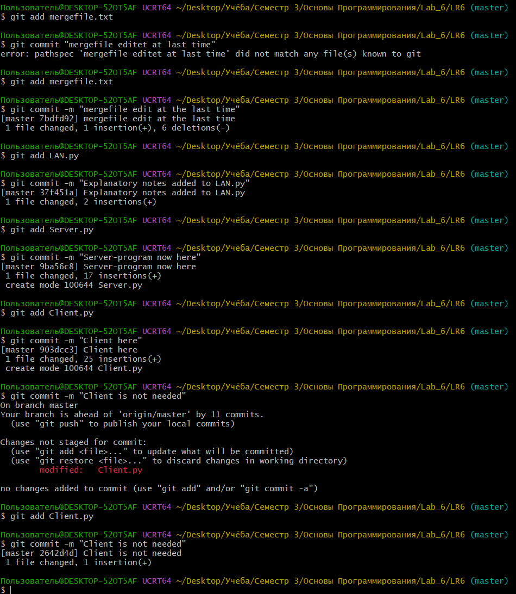

Был проведён откат последнего коммита.

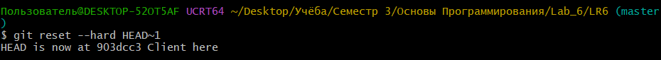

Была создана ветка для отчёта forlab_branch.

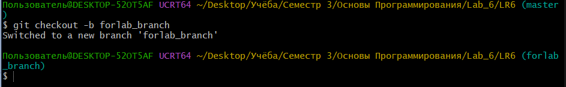

После этого всё из docx, в котором всё это время оформлялся отчёт, было грустно перенесено в читаемый файл README.md.
Также и рисунки поочерёдно сохранялись в папку images.

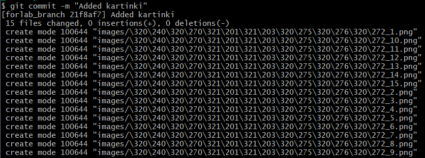

